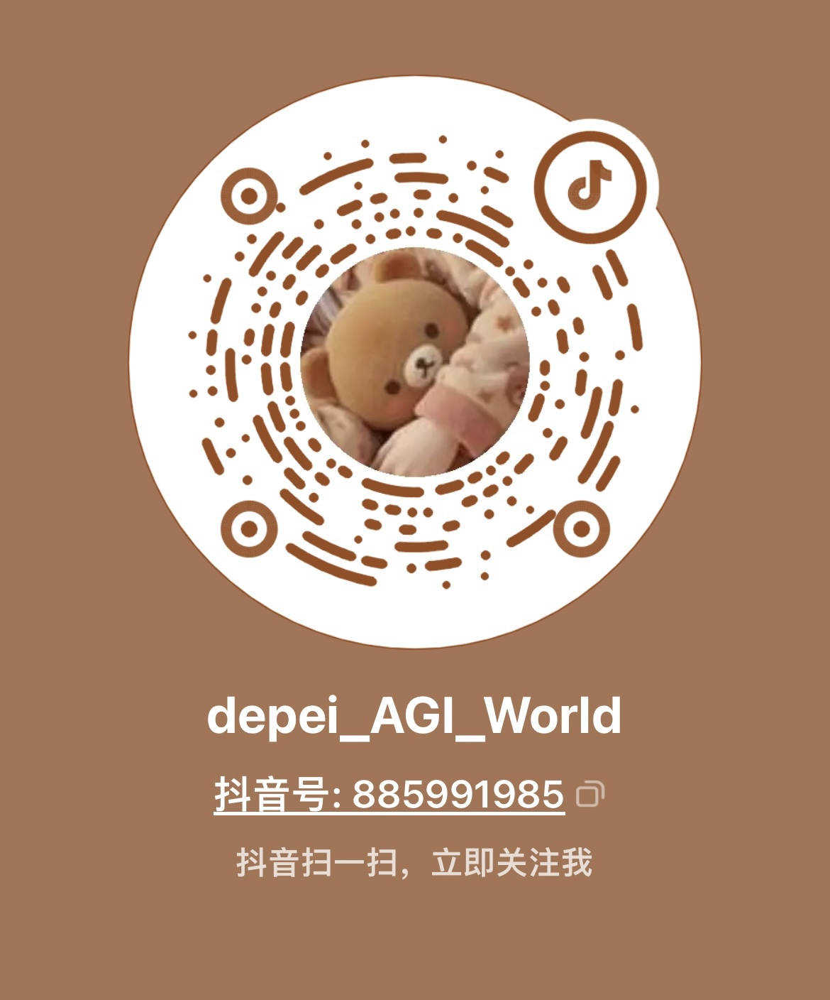

# MCTA Is All You Need

**Goal: infinite context for LLMs. Train once, extrapolate without retraining.**

MCTA (**M**ulti-level **C**onvolutional **T**ree **A**ttention) is a long-context
architecture with one shared attention layer, convolutional tree aggregation,
and recursive routing. You train it at a modest context length, then reuse the
same parameters at inference for much longer contexts.

---

## Why MCTA

Long-context models usually pay for context length twice:

1. attention grows quadratically with sequence length;
2. every new context length requires another training stage.

MCTA removes both costs from the architecture:

- attention is computed only over a small set of tree children at each level;
- the same `LevelCell` is reused recursively, so longer contexts add **tree
  depth**, not new parameters or new training stages.

The baseline in this repository was trained at **64K** and evaluated zero-shot
up to **8M** context.

---

## How it works

### 1. Blocks

The document is split into fixed **8K-token blocks**. A convolutional block
encoder plus attention pooling turns each block into one vector:

```
block_repr = AttentionPool(ConvBlock(token_embeddings))
```

### 2. One shared LevelCell

Every tree level uses the same cell:

```
c      = LayerNorm(children)              # (G, 2, d)
agg    = Linear(concat(c))                # (G, d)
parent = LayerNorm(agg + mean(c))         # residual + normalization
logits = Attn(q, c)                       # shared rq / rs, 2 children
```

- `children` are two block/parent representations.
- `parent` is the aggregated representation of their parent.
- `logits` score which child the query should follow.
- The **same attention weights** are used at every level. There is no
  per-level QKV.

### 3. Bottom-up tree, top-down routing

```
tokens
  -> 8K blocks
  -> 16K parents
  -> 32K parents
  -> ...
  -> root

query -> root
      -> choose child
      -> choose grandchild
      -> ...
      -> selected 8K block
      -> readout -> answer
```

The tree depth is `log2(context / 8K)`. The attention width at every level is
just two children.

### 4. Random-depth training

During training, each sample uses a random depth (1–3). This exposes the shared
cell to both block-level and parent-level inputs, so at inference the same cell
can be applied more times than seen during training.

### 5. Separate readout

Routing and copying have different objectives. MCTA therefore uses two paths:

- **route path**: shared tree cell, frozen when training the readout;
- **read path**: an 8K block encoder and token decoder that only sees the
  selected block.

The readout cost does not grow with the total context length.

---

## Train once, extrapolate to

The baseline route model was trained on **64K** data with random depth 1–3.
No retraining was done for longer contexts.

| Context | Route recall | Copy accuracy | Samples |
|---|---|---|---|
| 16K | 1.000 | 1.000 | 16 |
| 32K | 1.000 | 0.750 | 8 |
| 64K | 1.000 | 0.875 | 8 |
| 128K | 1.000 | 1.000 | 4 |
| 256K | 1.000 | 1.000 | 4 |
| 512K | 1.000 | 1.000 | 4 |
| 1M | 1.000 | 1.000 | 4 |
| 2M | 1.000 | 1.000 | 4 |
| 4M | 1.000 | 0.750 | 4 |
| 8M | 1.000 | 1.000 | 2 |
| 10M | 0.0–0.5 | 0.0–0.5 | 2 |

**Summary:** routing is stable from 16K to 8M with no retraining; 10M is the
current boundary. The copy numbers come from the synthetic 4-digit needle task
and should not be read as a general long-context reasoning benchmark.

---

## Model size

| Component | Parameters |
|---|---|
| Shared tree / route (`SharedTree`) | **5.36M** |
| 8K readout (`TreeAgg16V2`) | **6.69M** |
| Combined dual path | **12.0M** |

- `d = 256`, `S = 8192`, char-level vocabulary of 3000.
- Single 16GB GPU is enough for training and inference.
- Longer contexts add tree depth, not parameters.

---

## Structure

```
                         query
                           |
                     [ shared attention ]
                           |
        +------------------+------------------+
        |                                     |
     child 0                               child 1
        |                                     |
   LevelCell (same weights)             LevelCell (same weights)
        |                                     |
     ...                                   ...
        |                                     |
   8K block 0                            8K block 1
        |
   token readout -> answer
```

Key properties:

- one attention module, reused at every level;
- convolutional/linear aggregation builds parents;
- random-depth training enables recursive inference;
- route and readout are decoupled;
- no per-level QKV, no quadratic attention over the full context.

---

## Quick start

```bash
pip install torch
# put a .txt corpus under books/ (recursively read, UTF-8/GB18030/UTF-16)

python -m mcta.tree_shared_cell \
  --mode rdepth3 \
  --steps 6000 \
  --T 65536 \
  --res-mode mean \
  --save mean_route.pt

python -m mcta.tree_shared_cell \
  --mode extrap \
  --T 1048576 \
  --ckpt mean_route.pt
```

Readout / dual-path evaluation:

```bash
# expects state/sharedtree_rd3.pt and state/treeagg16v2_full.pt
python -m mcta.dual_path_blockread
```

For 8M/10M, `dual_path_chunked.py` encodes one 8K block at a time instead of
materializing the full token sequence.

---

## Repository layout

```
mcta/
  tree_shared_cell.py      # SharedTree + LevelCell + route training / extrapolation
  tree_agg_16k_v2.py       # 8K block readout
  sentence_memory_m1.py    # tokenizer, corpus reader, LM utilities
  expert_qwen.py           # RoPE / block utilities
  dual_path_blockread.py   # route + 8K readout, 16K–4M
  dual_path_chunked.py     # chunked block encoding, 8M/10M
```

---

## Community

Douyin QR code:



---

## Notes

- Checkpoints and corpora are not included.
- The task in the table is a synthetic needle test; treat it as a controlled
  extrapolation measurement, not a full long-context benchmark.
- `tree_shared_cell.py` keeps an attention-residual ablation
  (`--res-mode attn|both`). The baseline reported here is `mean`.
